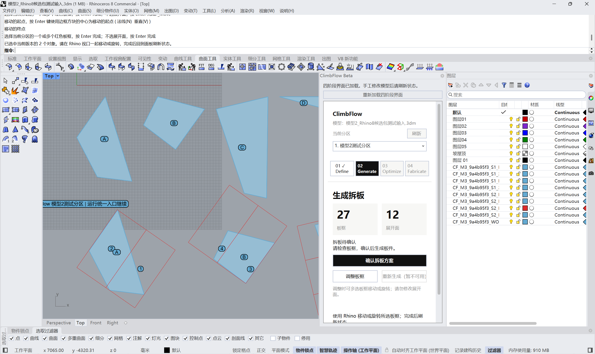
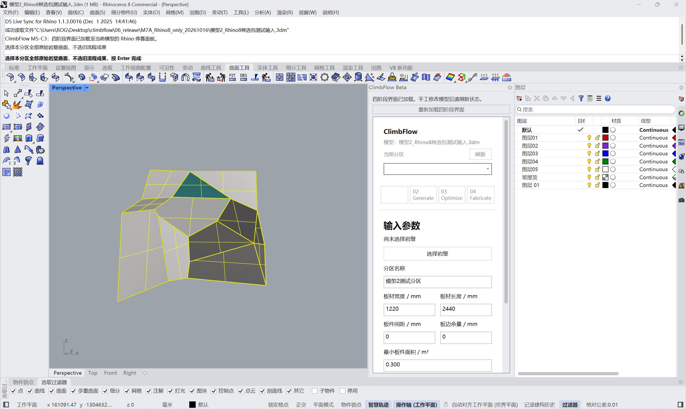
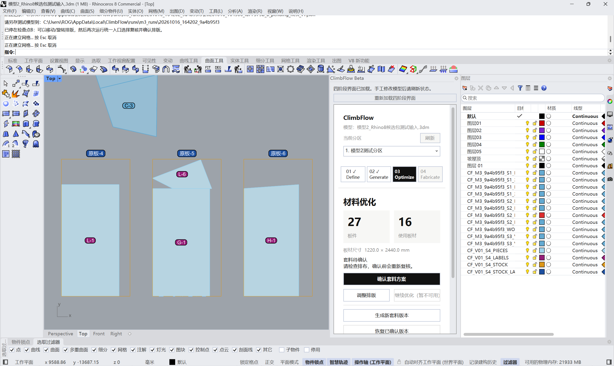
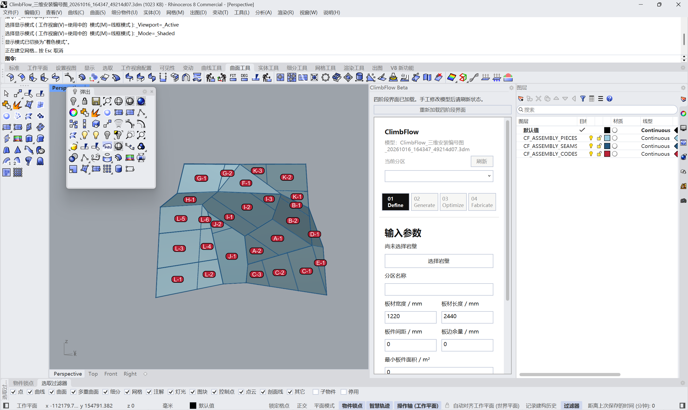

# ClimbFlow

## Download

**ClimbFlow Beta · Windows / Rhino 8**

Download the beta package from GitHub Releases.

[(https://github.com/LLXKKY/ClimbFlow/releases)]

> **Beta software:** This is an early testing version. Please review generated panel layouts and exported files before fabrication or installation.

**From 3D climbing wall design to panelization and installation documentation.**

ClimbFlow is a Rhino 8 plugin developed from a practical need in climbing wall design. It helps organize the workflow from 3D wall geometry to panel layouts and numbered installation references.

The project explores how automation and human review can work together to make a complex, repetitive design workflow more manageable.

## Screenshots

### 01. Plugin Interface

The ClimbFlow interface organizes the workflow into four stages, providing a structured way to move from geometry preparation to final outputs.

### 02. Original Climbing Wall Model

The original 3D model provides the geometric foundation for the panelization workflow.

### 03. Panelization and 2D Layout

Individual panels are arranged within sheet boundaries to prepare a layout for downstream fabrication workflows.

### 04. 3D Installation Guide

A numbered 3D reference helps identify individual panels and understand their positions during assembly.

## Key Features

- **Panelization** — Divide climbing wall geometry into individual panels.
- **Layout generation** — Arrange panel outlines within standard sheet boundaries.
- **Manual adjustment** — Review and adjust generated layouts, or regenerate a layout when needed.
- **DXF export** — Export 2D panel layouts for downstream fabrication workflows.
- **3D installation documentation** — Generate a numbered visual reference for panel identification and assembly.

## Workflow

1. **Prepare** — Start with a climbing wall model in Rhino 8.
2. **Generate** — Create panel geometry and an initial layout.
3. **Review** — Inspect the result, make manual adjustments, or regenerate the layout.
4. **Export** — Produce DXF files and a numbered 3D installation reference.

Rather than relying entirely on one-click automation, ClimbFlow combines automated generation with opportunities for human inspection and adjustment.

## Environment

- Rhino 8
- Windows

## Project Background

ClimbFlow originated from a real climbing wall design workflow, where repetitive panelization and layout adjustments created an opportunity for a more structured tool.

The project has since evolved into a standalone plugin with a dedicated interface, a user-facing download page in preparation, and a feedback workflow for future testing.

## Project Status

ClimbFlow is currently in beta testing.

The beta package for Windows and Rhino 8 is available through GitHub Releases.

The official website is being prepared. In the meantime, users can access the beta package and installation instructions through this repository.

Feedback from early users will help identify issues and guide future improvements.

## Documentation

- [Installation Guide](docs/installation.md)
- [Usage Guide](docs/usage.md)

## Repository Scope

This repository presents the product, workflow, screenshots, and supporting documentation. It does not include the plugin's implementation source code.
